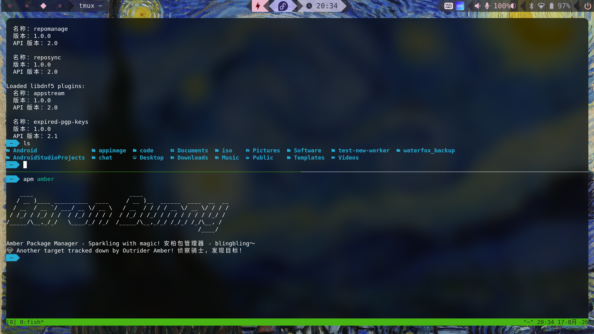

# lancetfish-niri-fedora
 
基于 [SHORiN-KiWATA/shorin-niri](https://github.com/SHORiN-KiWATA/shorin-niri) 的 Niri 桌面配置，经过个人定制与调整。

> **声明：** 本项目基于 shorin-niri 配置，部分内容由 AI 辅助生成和调整。如果显示网络问题建议开个代理 （fedora如果安装不上karing显示依赖不可用，可以先不用那个依赖 后面慢慢补依赖 不影响） 由于改动巨大所以决定重新设置一个仓库
## Preview 预览图



## 安装

安装脚本位于 `lancetfi.sh`，直接运行即会开始无人值守安装：

```bash
./lancetfi.sh
```

它会安装 Fish、Oh My Fish 与 Zen 浏览器，并逐文件备份将被覆盖的配置到 `~/.local/state/lancetfish-niri/backups/`。如需先检查计划而不改动系统或用户文件，请使用：

```bash
./lancetfi.sh --dry-run
```

脚本会同时启用本配置使用的 COPR 软件源：Waterfox、Yazi、PyCharm 和 Spark Store；RPM Fusion 也会在需要时启用。

可用 `--no-packages`、`--no-flatpak`、`--no-omf`、`--no-dotfiles`、`--no-assets` 跳过某类操作；`--desktop-settings` 和 `--set-fish-shell` 是默认关闭的可选改动。完整选项请运行 `./lancetfi.sh --help`。

## 为什么选择我们

- 首先，我们的foot十分美观 
- 其次，我们的foot占用十分小
- 还有，我们的这几句话的主语用的是我们，
- 最后，觉得有问题可以提交议题，觉得没问题可以发到youtube,x,bilibili上炫耀一下哦(@_@)

详细的使用方法、快捷键说明、输入法配置等请参考原版项目：

- [shorin-niri 原版仓库](https://github.com/SHORiN-KiWATA/shorin-niri)
- [功能介绍文档](https://github.com/SHORiN-KiWATA/Shorin-ArchLinux-Guide/wiki/ShorinNiri%E5%8A%9F%E8%83%BD%E4%BB%8B%E7%BB%8D)

## 致谢

感谢 [SHORiN-KiWATA](https://github.com/SHORiN-KiWATA) 提供的优秀 Niri 桌面配置方案。
感谢 [ThousandPairsThousandWings](https://github.com/ThousandPairsThousandWings/niri-withstar-animations-open-and-close-windows.git)提供的漂亮的动画
